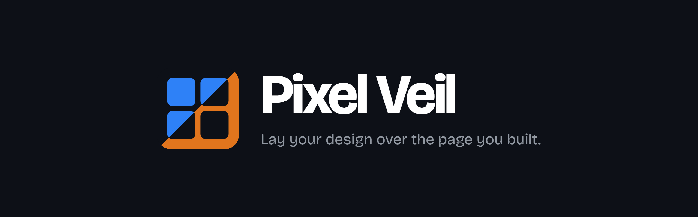
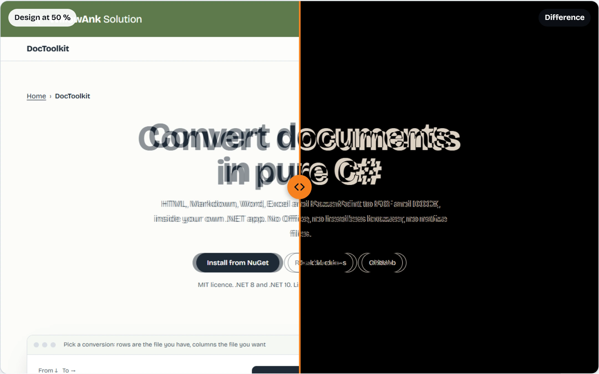
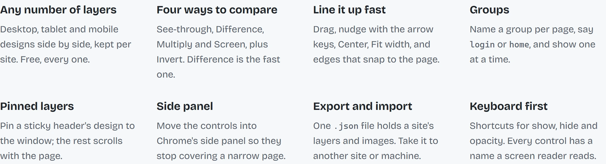
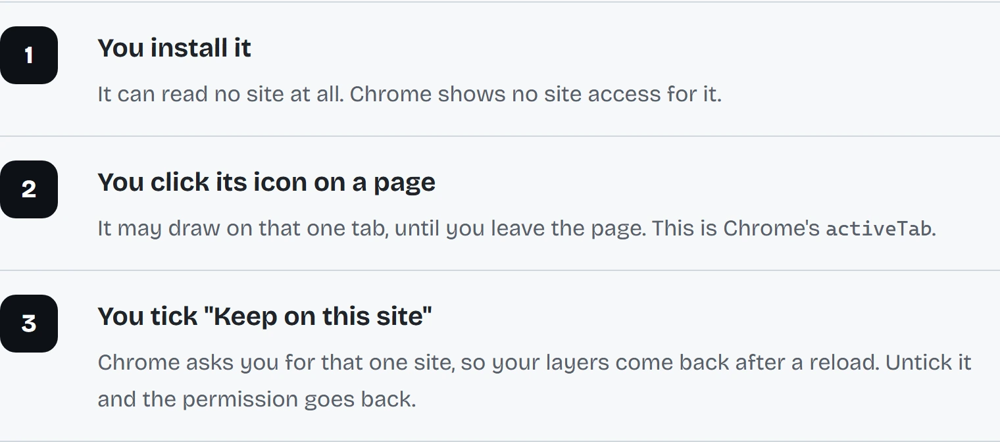

# Pixel Veil

*Lay your design over the page you built. Every pixel that disagrees shows.*

## What it is

  

  <strong>Unlimited layers &middot; no account &middot; no site access until you click</strong> 
  Left: the design at 50 % over the live page. Right: Difference view, where matching pixels turn black.
  <a href="https://ank-khoaho.github.io/pixel-overlay/">Drag the line yourself</a> on the project page.

Pixel Veil is a free Chrome extension for front-end developers who build pages from a design export:
a Figma frame as a PNG, a screenshot, anything that is an image. It costs nothing, needs no account,
and reads no site until you click its icon.

You know the moment. The page is done, the designer opens it next to the mockup, squints, and says the
heading is "a little low". A little. Pixel Veil puts the mockup on top of your page, so you see
"a little" in pixels, before anyone else does.

## Get started

Pixel Veil is not on the Chrome Web Store yet. Download the Chrome zip from
[the latest release](https://github.com/Ank-KhoaHo/pixel-overlay/releases/latest), unzip it, and load the
folder with **Load unpacked** at `chrome://extensions`.

Building from source, Edge and Firefox are in
[Getting started](https://ank-khoaho.github.io/pixel-overlay/guide/getting-started).

## How to use it

1. Open your page and click the **Pixel Veil** icon. A panel appears at the top right.
2. Click **Add image**, drop image files on the panel, or paste one with Ctrl+V.
3. Move the layer into place, set its see-through level, or switch to **Difference**.
4. Switch on **Keep on this site** to have the layers come back after a reload. Chrome asks once per site.
5. Click the icon again to hide everything.

Groups, pinned layers, the side panel, export and every shortcut are in
[the guide](https://ank-khoaho.github.io/pixel-overlay/guide/).

## What it does

  <picture>
    <source media="(prefers-color-scheme: dark)" srcset="site/img/features-dark.webp">
    
  </picture>

## It asks for as little as it can

  <picture>
    <source media="(prefers-color-scheme: dark)" srcset="site/img/privacy-dark.webp">
    
  </picture>

Your images stay in your browser, and Pixel Veil sends nothing anywhere. The details are in
[Privacy and permissions](https://ank-khoaho.github.io/pixel-overlay/guide/privacy).

## Status

Version 0.2.2, before its first Store release. 117 end-to-end tests drive the built extension in
Chromium, on Windows and in CI. Edge and Firefox are not tried yet:
[what has really been tried](https://ank-khoaho.github.io/pixel-overlay/guide/reference#what-has-really-been-tried).

## Limits

- Images: PNG, JPEG, WebP and GIF, up to 25 MB each. SVG is not accepted.
- Layers are kept per site, not per page. Groups show one page's designs at a time.
- Chrome does not let extensions draw on its own pages (`chrome://`, the Web Store).

Every limit is in [Limits and questions](https://ank-khoaho.github.io/pixel-overlay/guide/reference).

## Alternatives

Pixel Veil is the right tool when you hold an image of the design and a page to check against it.
Something else is better in these cases:

- **You measure spacing, not compare a picture.** Your design tool's own inspect or developer mode
  gives exact sizes, and your browser's DevTools give the page's.
- **You want a test to fail when a page changes.** A screenshot test, such as Playwright's
  `toHaveScreenshot`, compares every build without a person looking.
- **You need the overlay in a browser other than Chrome, Edge or Firefox.** Look for an overlay
  extension in that browser's own store.

## FAQ

**Is it really free?**
Yes. Every layer, no account, no paid plan waiting behind a button.

**Why does it need a click before it works on a page?**
Because that click is the permission. Pixel Veil starts with access to no site, and an extension that can
read nothing until you ask has nothing to leak.

**Why "veil"?**
A veil is thin enough to see through. Lay it over the page, and the only things that stand out are the
ones that should not.

More answers are in [Limits and questions](https://ank-khoaho.github.io/pixel-overlay/guide/reference#questions).

## Documentation

| File | What it holds |
|---|---|
| [The guide](https://ank-khoaho.github.io/pixel-overlay/guide/) | every control, step by step, with search; its pages are [guide/](guide/README.md) |
| [CONTRIBUTING.md](CONTRIBUTING.md) | how to build and test it, and what gets rejected |
| [SECURITY.md](SECURITY.md) | how to report a vulnerability, and what is not one |
| [ROADMAP.md](ROADMAP.md) | direction, and the things deliberately not coming |
| [CHANGELOG.md](CHANGELOG.md) | what changed in each version |
| [PUBLIC.md](PUBLIC.md) | why some material is deliberately not published here |
| [site/](site/index.html) | the project page, served by GitHub Pages beside the guide |
| [art/icon.svg](art/icon.svg) | the icon; `node scripts/make_icons.mjs` renders the PNGs in `public/icon/` |
| [art/banner.png](art/banner.png) | the banner this README opens with |
| [art/cover.png](art/cover.png) | the cover: the Chrome Web Store's small tile, 440&times;280 |

The repository keeps its first working name, `pixel-overlay`.

## Licence

[MIT](LICENSE). Use it, change it, ship it. Version 0.2.2, before its first Store release.
