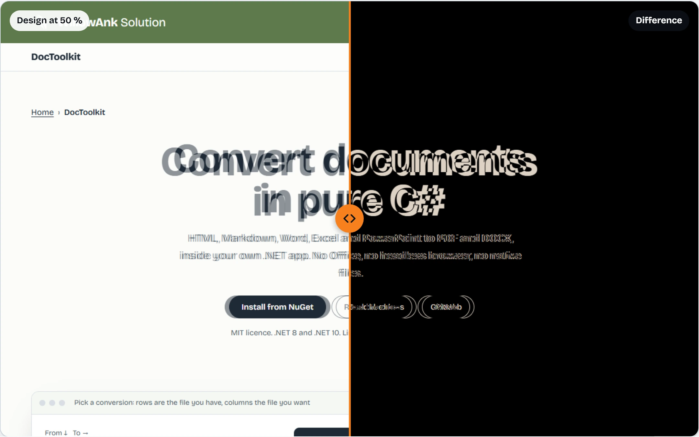
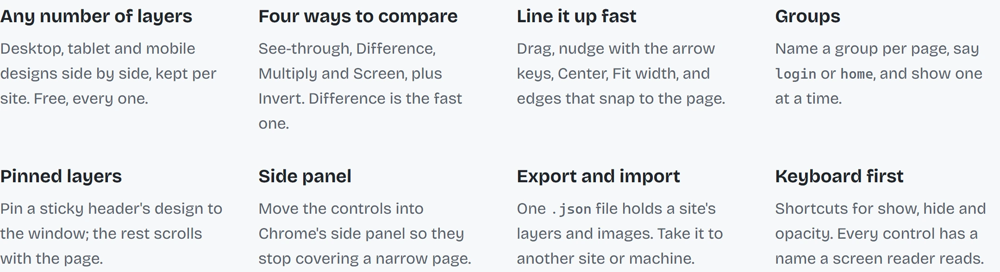
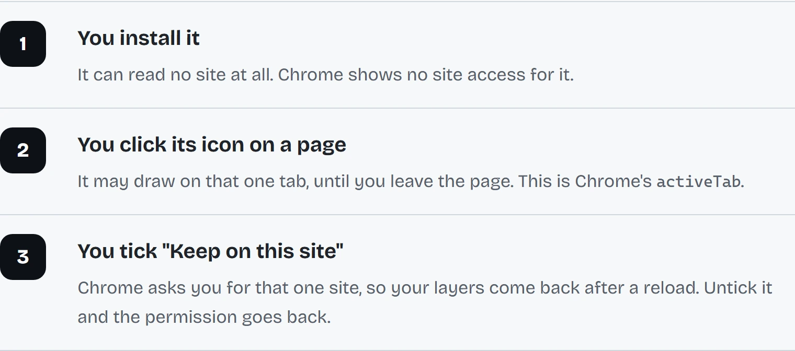

<p align="center">
  
</p>

<h1 align="center">Pixel Veil</h1>

<p align="center">
  <em>Lay your design over the page you built. Every pixel that disagrees shows.</em>
</p>

<p align="center">
  <a href="https://github.com/Ank-KhoaHo/pixel-overlay/actions/workflows/ci.yml"></a>
  
  
  
  
</p>

<p align="center">
  <a href="https://ank-khoaho.github.io/pixel-overlay/"></a>
</p>

<p align="center">
  <strong>Unlimited layers &middot; no account &middot; no site access until you click</strong><br>
  <sub>Left: the design at 50 % over the live page. Right: Difference view, where matching pixels turn black.
  <a href="https://ank-khoaho.github.io/pixel-overlay/">Drag the line yourself</a> on the project page.</sub>
</p>

Pixel Veil is a free Chrome extension for front-end developers who build pages from a design export:
a Figma frame as a PNG, a screenshot, anything that is an image. It costs nothing, needs no account,
and reads no site until you click its icon.

You know the moment. The page is done, the designer opens it next to the mockup, squints, and says the
heading is "a little low". A little. Pixel Veil puts the mockup on top of your page, so you see
"a little" in pixels, before anyone else does.

## What it does

<p align="center">
  <picture>
    <source media="(prefers-color-scheme: dark)" srcset="site/img/features-dark.webp">
    
  </picture>
</p>

Drop an image on the panel, line it up with drag, arrow keys, **Center** or **Fit width**, then switch to
**Difference**. Keep desktop, tablet and mobile designs side by side, and group them per page. Pin a
sticky header's design to the window. Move the controls into Chrome's side panel when they cover a
narrow page.

## It asks for as little as it can

<p align="center">
  <picture>
    <source media="(prefers-color-scheme: dark)" srcset="site/img/privacy-dark.webp">
    
  </picture>
</p>

Your images and settings stay in your browser (`chrome.storage.local`). Pixel Veil sends nothing anywhere,
has no account, and keeps its layers in a closed shadow root that the page cannot read. The full promise,
and what does not count as breaking it, is in [SECURITY.md](SECURITY.md).

## Install

| Where | How | Status |
|---|---|---|
| **Chrome, from source** | Build it, then **Load unpacked** (below) | Works today |
| **Chrome Web Store** | One click | Listing in preparation |
| **Edge** | The Chrome build, loaded the same way | Same build; not tried in Edge yet |
| **Firefox 140+** | `npm run build:firefox`, then `about:debugging` | Built and linted; not yet run in Firefox |

From source takes about a minute:

```bash
git clone https://github.com/Ank-KhoaHo/pixel-overlay
cd pixel-overlay
npm ci
npm run build
```

Then open `chrome://extensions`, turn on **Developer mode**, choose **Load unpacked**, and pick
`.output/chrome-mv3`. Pin Pixel Veil to the toolbar.

## Use it

1. Open your page and click the **Pixel Veil** icon. A panel appears at the top right.
2. Click **Add image**, drop image files on the panel, or paste one with Ctrl+V.
3. Move the layer into place, set its see-through level, or switch to **Difference**.
4. Switch on **Keep on this site** to have the layers come back after a reload. Chrome asks once per site.
5. Click the icon again to hide everything.

More, when you need it:

- **Export** saves this site's layers and images to one `.json` file; **Import** adds them on any site or computer.
- **Side panel** moves the controls into Chrome's side panel. The page panel comes back when you close it.
- **Group** names a layer's group (say `login` or `home`); the list above the layers then shows one group at a time.
- **Fixed to window** pins a layer to the window, for sticky headers and footers.

## Shortcuts

| Keys | What they do |
|---|---|
| Alt+Shift+V | Show or hide Pixel Veil, like the icon |
| Alt+Shift+H | Hide or show all layers |
| Alt+Shift+. and Alt+Shift+, | Active layer 10 % more solid, or 10 % more see-through |
| Arrow keys (Shift for 10 px) | Nudge the active layer |
| F2 on a layer's name | Rename it |
| (none set) | Turn Difference view on or off; pick your own keys |

Change them in `chrome://extensions/shortcuts`. Every control also works from the keyboard and has a name
a screen reader reads.

## Limits

- Images: PNG, JPEG, WebP and GIF, up to 25 MB each. SVG is not accepted.
- Layers are kept per site (scheme, host and port), not per page: `/login` and `/home` share one list.
  Groups show one page's designs at a time.
- Local files (`file://`) work after you turn on **Allow access to file URLs** in the extension's details;
  Pixel Veil opens a page that shows how. Layers are kept per folder there, and **Keep on this site** is off.
- A layer pinned to the window is always drawn above the layers that scroll with the page.
- Chrome does not let extensions draw on its own pages (`chrome://`, the Web Store).

## Status

Version 0.2.2, before its first Store release. What has really been tried:

| What | How it was tried |
|---|---|
| Chromium on Windows | 117 end-to-end tests drive the built extension |
| Chromium on Linux | the same tests, on every push, in CI |
| Edge | not tried; it is the same build |
| Firefox 140+ | built, and passes Mozilla's own linter; not yet run in Firefox |
| Chrome Web Store | listing in preparation |

## Alternatives

Pixel Veil is the right tool when you hold an image of the design and a page to check against it.
Something else is better in these cases:

- **You measure spacing, not compare a picture.** Your design tool's own inspect or developer mode
  gives exact sizes, and your browser's DevTools give the page's.
- **You want a test to fail when a page changes.** A screenshot test, such as Playwright's
  `toHaveScreenshot`, compares every build without a person looking.
- **You need the overlay in a browser other than Chrome, Edge or Firefox.** Look for an overlay
  extension in that browser's own store.

## FAQ

**Is it really free?**
Yes. Every layer, no account, no paid plan waiting behind a button.

**Why does it need a click before it works on a page?**
Because that click is the permission. Pixel Veil starts with access to no site, and an extension that can
read nothing until you ask has nothing to leak.

**Will it slow my page down?**
Ten 4000x8000 designs took 1.8 seconds to show and added no time per frame while dragging or scrolling.

**Does it work on localhost?**
Yes, like any other site. That is where most of the checking happens.

**Why "veil"?**
A veil is thin enough to see through. Lay it over the page, and the only things that stand out are the
ones that should not.

## Where things live

| File | What it holds |
|---|---|
| [CONTRIBUTING.md](CONTRIBUTING.md) | how to build and test it, and what gets rejected |
| [SECURITY.md](SECURITY.md) | how to report a vulnerability, and what is not one |
| [ROADMAP.md](ROADMAP.md) | direction, and the things deliberately not coming |
| [PUBLIC.md](PUBLIC.md) | why some material is deliberately not published here |
| [site/](site/index.html) | the project page, served by GitHub Pages |
| [art/icon.svg](art/icon.svg) | the icon; `node scripts/make_icons.mjs` renders the PNGs in `public/icon/` |

The repository keeps its first working name, `pixel-overlay`.

## License

[MIT](LICENSE). Use it, change it, ship it. Version 0.2.2, before its first Store release.
