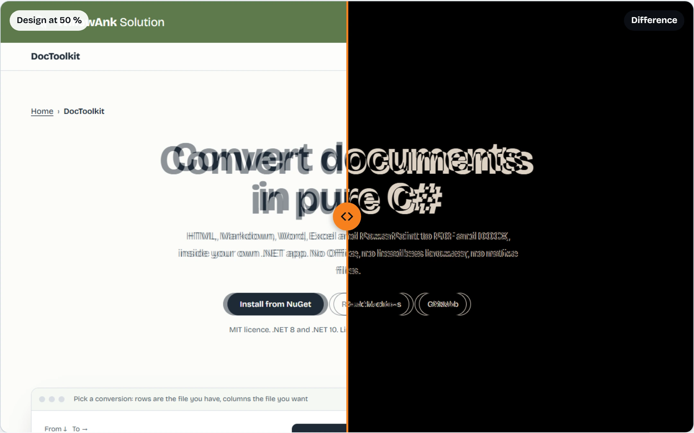

# Getting started

Pixel Veil lays a design image over the page you built, so you can see every pixel that disagrees. This guide covers every control. Start here: install it, then lay your first design.

## Install

Pixel Veil is not on the Chrome Web Store yet. Until it is, load it into Chrome yourself. It takes a minute either way.

| Browser | How | Status |
|---|---|---|
| Chrome | The Chrome zip from a release, or built from source | Works today |
| Edge | The same Chrome zip, loaded the same way | Same build; not tried in Edge yet |
| Firefox 140+ | The Firefox zip from a release | Built and linted; not run in Firefox yet |
| Chrome Web Store | One click | Listing in preparation |

### Chrome, from a release

1. Open [the latest release](https://github.com/Ank-KhoaHo/pixel-overlay/releases/latest) and download `pixel-overlay-<version>-chrome.zip`.
2. Unzip it into a new, empty folder. The files sit at the top of the zip, with no folder of their own.
3. Open `chrome://extensions` and turn on **Developer mode**.
4. Click **Load unpacked** and pick the folder you unzipped into.
5. Pin Pixel Veil to the toolbar, so its icon is one click away.

> Keep the folder. Chrome loads the extension from it each time it starts.

### Chrome, from source

```
git clone https://github.com/Ank-KhoaHo/pixel-overlay
cd pixel-overlay
npm ci
npm run build
```

Then load the `.output/chrome-mv3` folder with **Load unpacked**, as in steps 3 to 5 above.

### Firefox

Nobody has run the Firefox build in Firefox yet. To try it, open `about:debugging`, choose **This Firefox**, click **Load Temporary Add-on**, and pick the Firefox zip. Firefox removes a temporary add-on when it closes. The Firefox build has no side panel button.

## Your first overlay

1. Open your page, on `localhost` or anywhere else, and click the **Pixel Veil** icon. The panel appears at the top right.
2. Click **Add image** and pick an export of the design: a Figma frame as a PNG, say. You can also drop image files on the panel, or paste one with <kbd>Ctrl</kbd>+<kbd>V</kbd>.
3. Drag the design into place. It starts at 50 % see-through.
4. Click **Difference**. Pixels that match turn black; whatever is not black differs.
5. Click the icon again to hide all layers. One more click shows them again.



*Left of the line, the design at 50 %. Right of it, Difference: only what disagrees stays visible.*

Your layers stay with the site. Tick **Keep on this site** to have them come back after a reload: see [Keep on this site](organise.md#keep-on-this-site).
