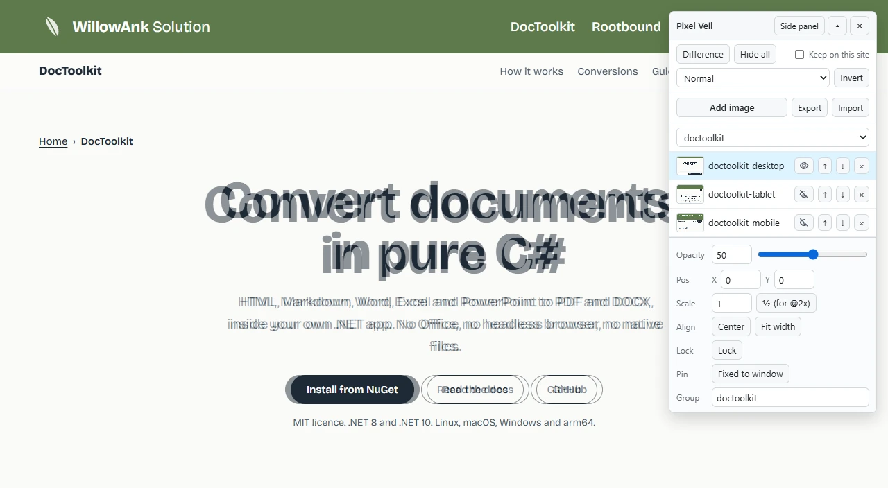
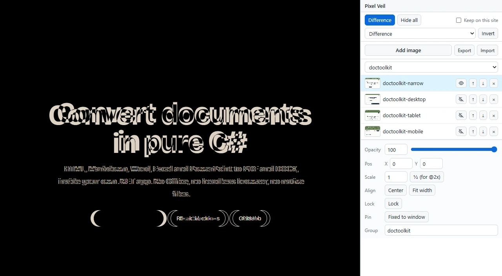

# Organise your layers

Keep desktop, tablet and phone designs side by side, sort them by page, and take them with you.

## The layer list

The list shows the top layer first. On each row:

- **The name** makes the layer active. The active one is marked.
- **Double-click the name**, or press <kbd>F2</kbd> on it, to rename the layer. <kbd>Enter</kbd> keeps the new name; <kbd>Esc</kbd> keeps the old one.
- **↑ and ↓** move the layer up or down the stack.
- **The eye** hides or shows it.
- **Delete** needs a second click within 3 seconds. Deleting a layer deletes its image too.

## Groups

Layers are kept per site, not per page, so a site's login and home designs share one list. A group sorts them.

1. Make a layer active, type a name in its **Group** field (`login`, say), and press <kbd>Enter</kbd>.
2. Pick that group in the **Show group** list above the layers. The list and the page then show that group alone.
3. Pick **All layers** to see every layer again.

*One group shown: the list and the page show one page's designs.*

## Pin a layer to the window

**Fixed to window** keeps a layer still while the page scrolls under it. Use it for a sticky header or footer. A pinned layer is always drawn above the layers that scroll with the page.

## Keep on this site

Without it, a reload hides the layers until you click the icon again. With **Keep on this site** ticked, they come back by themselves after every reload.

Chrome asks you once, for that one site (its scheme, host and port). Untick it and Pixel Veil gives the permission back. On a kept site, clicking the icon never draws a second copy of the layers.

## Local files

To check a page opened from disk (`file://`), turn on **Allow access to file URLs** in Pixel Veil's details at `chrome://extensions`. Until you do, the icon opens a page that shows how. Layers are kept per folder there, and **Keep on this site** is off.

## Export and import

**Export** saves this site's layers and their images to one `.json` file, named after the site. **Import** adds the layers from such a file to the site you are on, on this computer or any other. Use it to move designs from `localhost` to a staging site, or to hand them to a colleague.

## The side panel

On a narrow page the panel can cover what you check. **Side panel** moves the controls into Chrome's side panel, beside the page. Close the side panel and the panel on the page comes back. The Firefox build has no side panel.

*The page in Difference view, and the controls in the side panel.*

The panel on the page moves by its title bar. **▴** folds it down to the title, and **×** closes it. If it was left outside a smaller window, it comes back inside.
